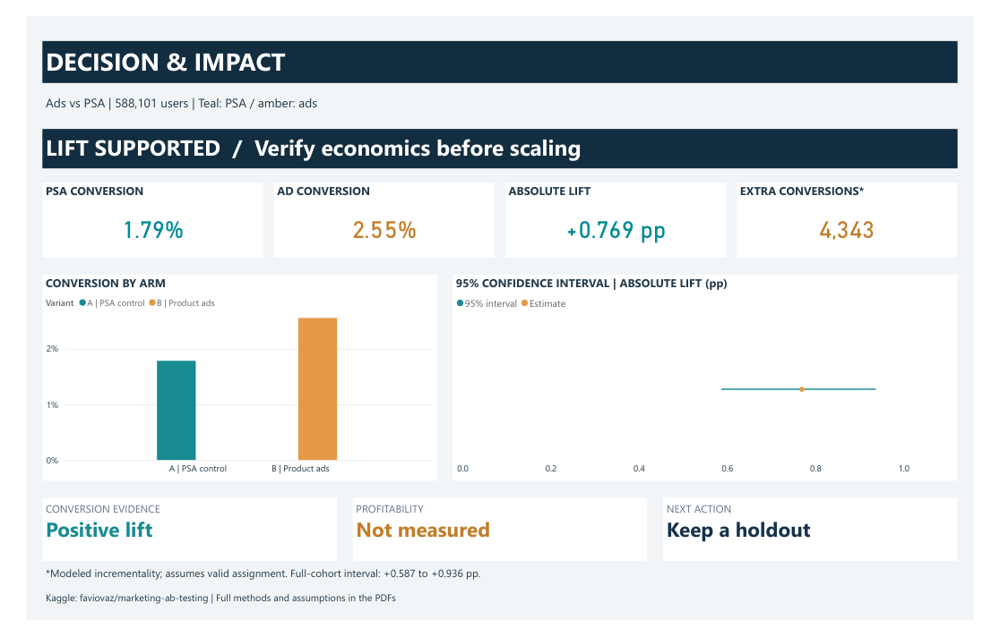
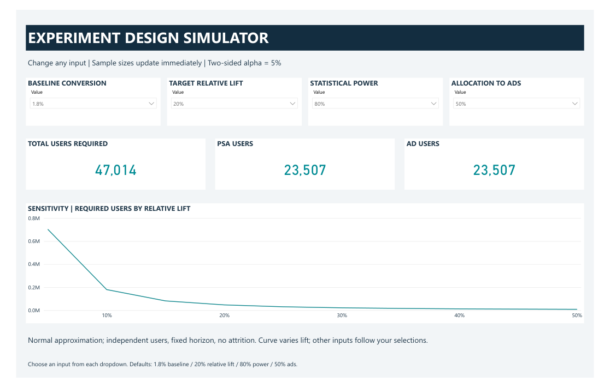

# Marketing A/B Testing: Does Product Advertising Increase Conversions?

## Problem statement

A marketing team needs to decide whether product advertising improves user conversion compared with showing a public service announcement (PSA), and whether the evidence supports scaling the campaign. The analysis also asks what a better follow-up experiment should look like.

The dataset contains **588,101 users**: 564,577 in the ad group and 23,524 in the PSA group. Each user has a binary conversion outcome and recorded exposure frequency, peak weekday and peak hour. Costs and revenue are unavailable, so the project can assess conversion evidence and illustrate economic thresholds, but cannot measure profitability.

## Investigation

1. **Audit the data:** check user uniqueness, missing values, categories, exposure extremes and the highly unequal allocation. Retain all valid source users.
2. **Test the primary hypothesis:** compare ad and PSA conversion rates using a two-sided pooled two-proportion test; quantify absolute lift, relative lift and a 95% Newcombe confidence interval.
3. **Check robustness:** cross-check with Fisher exact and chi-square tests, binomial resampling and an exposure-tail sensitivity.
4. **Explore patterns:** examine frequency, weekday and hour with denominators and uncertainty; apply Holm correction across 31 exploratory weekday/hour tests and examine treatment interactions.
5. **Connect evidence to decisions:** estimate conditional incrementality, illustrate margin/CPM break-even scenarios, and build a prospective sample-size simulator.

[Full SQL investigation](marketing/output/pdf/Marketing_AB_Queries_and_Investigation.pdf) | [Executed SQL](marketing/src/investigation.sql)

## Findings

| Metric | PSA control | Product ads |
| --- | ---: | ---: |
| Users | 23,524 | 564,577 |
| Converted users | 420 | 14,423 |
| Conversion rate | 1.7854% | 2.5547% |

- **Absolute conversion lift: +0.769 percentage points**, with a 95% Newcombe interval of **+0.587 to +0.936 pp**. This corresponds to approximately 77 additional conversions per 10,000 comparable users.
- **Relative lift: +43.09%; risk ratio: 1.431.** The primary two-sided p-value is 1.70528e-13. Alternative inferential checks support the positive direction.
- **Modeled additional conversions: about 4,343** in the ad cohort, conditional on valid assignment and comparable measurement. This is counterfactual attribution, not directly observed individual causation.
- **No missing meaningful values or duplicate user IDs** were found; no source users were excluded. The observed allocation is roughly 96% ads / 4% PSA. An unequal split is not an allocation failure without knowing the planned split. The small PSA arm contributes about 94% of uncertainty in the rate difference.
- **Exposure is concentrated:** roughly 1% of users account for 13% of recorded impressions. Conversion increases with observed exposure in both arms; this does not establish that additional impressions cause purchases.
- **Profitability is unresolved.** Actual campaign costs and contribution margin are missing. Economic scenarios are hypothetical, not measured ROI.

## Business recommendation

The recorded conversion evidence supports product ads relative to PSA. **Preserve a randomized holdout, validate assignment and the conversion window, and obtain actual campaign costs and contribution margin before scaling spend.** Use randomized frequency-cap or scheduling trials to test operational changes; do not optimize delivery from observational exposure charts alone.

## Final Power BI dashboard



The five pages separate the main business decision from experiment planning, evidence and exploratory patterns:

1. **Decision & impact:** conversion, lift, confidence interval and modeled incrementality.
2. **Experiment design simulator:** adjustable baseline conversion, target lift, power and ad allocation.
3. **Evidence:** primary test, risk ratio, allocation and PSA variance contribution.
4. **Exposure explorer:** frequency and impression concentration, prominently labeled observational.
5. **Timing explorer:** descriptive peak-weekday/hour profiles with denominators and filtering.

[Download Power BI dashboard](marketing/output/powerbi/Marketing_AB_Dashboard_Final.pbix) | [View final dashboard PDF](marketing/output/pdf/Marketing_AB_Dashboard_Final.pdf)

## Planning the next experiment



The native Power BI simulator recalculates sample sizes from four selectable inputs. At a **1.8% baseline, 20% relative lift, 80% power and 50/50 allocation**, it requires **47,014 users**, or 23,507 per arm. Increasing power to 90% raises the total to 62,938; allocating 96% to ads raises it to 315,650. The independent calculation checks and exact DAX are included.

The sensitivity curve varies target lift from 5% to 50%, holding baseline, power and allocation fixed. Inputs are discrete dropdown values; two-sided significance is fixed at 5%. Planning assumes independent users, fixed follow-up and no attrition. The report's fixed scenarios use the unrounded observed PSA baseline of 1.7854%, explaining the small difference from the simulator's default results. The PDF is static; download the PBIX to use the controls.

## Limits of the evidence

The dataset lacks assignment logs, intended allocation, experiment dates, conversion timestamps and window definitions, costs and revenue. Causal interpretation of the arm comparison remains conditional on valid experimental design and comparable tracking. PSA is the comparator, not necessarily no advertising. Exposure frequency and peak day/hour may be post-assignment; their patterns do not identify a causal dose, optimal cap or winning schedule.

## Deliverables and methods

- [Analysis report](marketing/output/pdf/Marketing_AB_Deep_Analysis_Report.pdf): 15 pages of investigation, findings, business implications, limitations and final-dashboard documentation.
- [Queries and investigation](marketing/output/pdf/Marketing_AB_Queries_and_Investigation.pdf): 42 pages containing complete SQL, outputs, interpretations, statistical formulas and simulator DAX.
- [Python analysis](marketing/src/analyze.py), [DAX measures](marketing/src/dashboard_measures.dax), [validation checks](marketing/src/validate.py) and [simulator checks](marketing/src/validate_simulator.py).
- [Project guide](marketing/README.md): input ranges, dashboard behavior, assumptions and reproduction details.

Tools: **Python, pandas, NumPy, SciPy, SQLite, SQL, Power BI, DAX and ReportLab**.

## Reproduce

Download the original CSV from [Favio Vazquez's Marketing A/B Testing dataset on Kaggle](https://www.kaggle.com/datasets/faviovaz/marketing-ab-testing) into `marketing/data/marketing_AB.csv`, then run from the repository root:

```bash
python -m pip install -r marketing/requirements.txt
python marketing/src/analyze.py
python marketing/src/report.py
python marketing/src/validate.py
python marketing/src/validate_simulator.py
```

Raw user-level records are acquired separately; derived aggregates, query outputs and final artifacts are included. The supplied PBIX embeds aggregate data without user IDs and opens without a Kaggle connection. Report generation uses the included final-export preview images.

Final dashboard aligned to the approved export on **02 November 2026**. The dataset remains attributed to its original publisher.

Generated Power BI project definitions, templates, intermediate JSON/CSV outputs and duplicate assets are omitted from this portfolio repository. The analysis script regenerates the intermediate files needed by the report and validation scripts.
