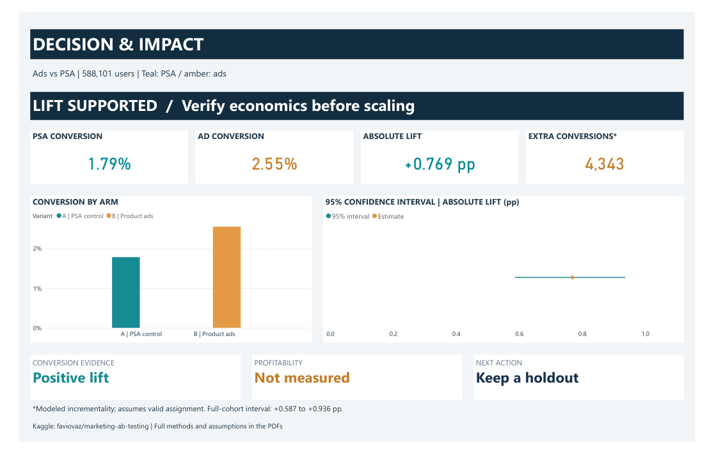
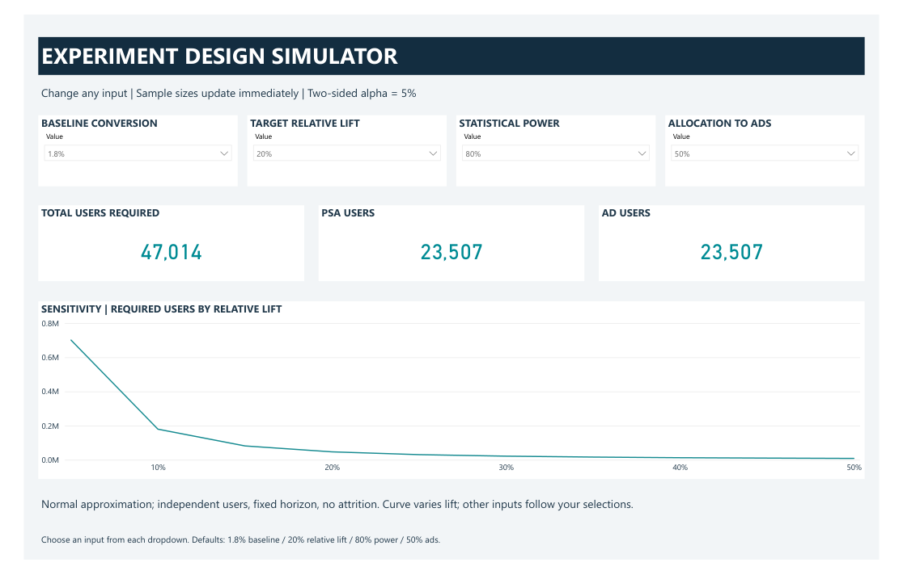
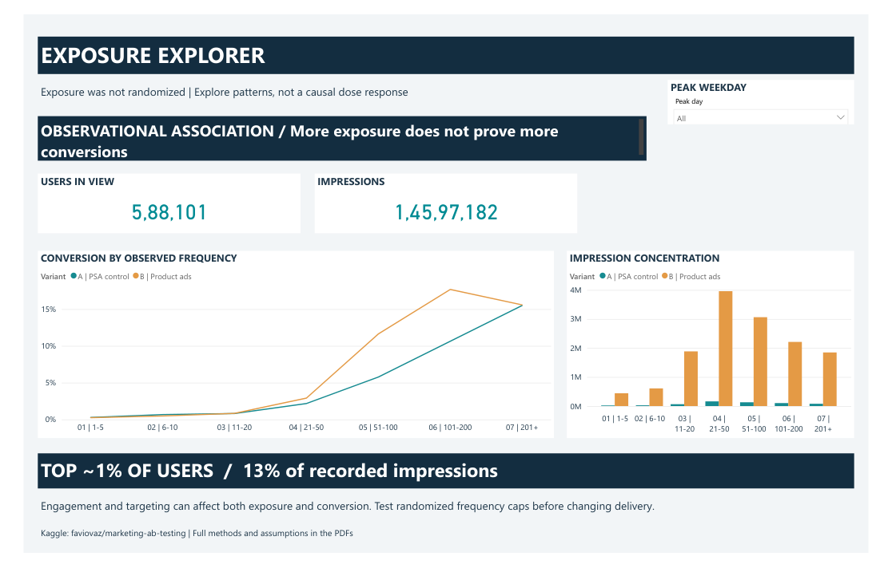

# Marketing A/B Testing

A complete analysis of product advertising versus a PSA holdout, with a five-page Power BI dashboard and an interactive experiment-design simulator.



## Decision

The recorded ad-arm conversion rate is higher, with **+0.769 percentage points** absolute lift (95% Newcombe interval **+0.587 to +0.936 pp**). Preserve a randomized holdout and validate assignment, measurement and campaign economics before scaling. Profitability is not measured in this dataset.

| Metric | PSA control | Product ads |
| --- | ---: | ---: |
| Users | 23,524 | 564,577 |
| Conversions | 420 | 14,423 |
| Conversion rate | 1.7854% | 2.5547% |

Relative lift is 43.0851%. The primary two-sided pooled proportion test gives p = 1.70528e-13. Statistical significance does not verify randomization or establish profit.

## Open the deliverables

- [Power BI dashboard (.pbix)](output/powerbi/Marketing_AB_Dashboard_Final.pbix) - interactive, embedded aggregate data; download and open in Power BI Desktop.
- [Final dashboard export](output/pdf/Marketing_AB_Dashboard_Final.pdf) - the approved five-page visual snapshot.
- [Analysis report](output/pdf/Marketing_AB_Deep_Analysis_Report.pdf) - 15 pages of results, business implications, limitations and final-dashboard documentation.
- [Queries and investigation](output/pdf/Marketing_AB_Queries_and_Investigation.pdf) - 42 pages with complete SQL, returned results, formulas, interpretations and simulator DAX.

## Dashboard pages

1. **Decision & impact:** conversion rates, absolute lift, uncertainty and modeled incrementality.
2. **Experiment design simulator:** change baseline conversion, target relative lift, power and allocation to ads; sample sizes recalculate.
3. **Evidence:** p-value, risk ratio, allocation and the PSA arm's contribution to uncertainty.
4. **Exposure explorer:** frequency patterns and impression concentration, explicitly labeled observational.
5. **Timing explorer:** descriptive weekday/hour profiles, denominators and a weekday filter.

Teal represents PSA; amber represents product ads. The final export and current PBIX have no Studio branding. Query details and extended prose remain in the reports.

## Interactive experiment design



The simulator has native single-selection dropdowns, not unrestricted numeric entry:

| Input | Available values | Default |
| --- | --- | --- |
| Baseline conversion | 0.5%, 1%, 1.5%, 1.8%, 2%, 2.5%, 3%, 4%, 5%, 7.5%, 10% | 1.8% |
| Relative lift | 5% to 100%, steps of 5 percentage points | 20% |
| Power | 80%, 85%, 90%, 95% | 80% |
| Allocation to ads | 50%, 60%, 70%, 75%, 80%, 85%, 90%, 95%, 96% | 50% |

Two-sided alpha stays fixed at 5%. The default requires **47,014 users** (23,507 per arm). At 90% power, the total becomes 62,938; at 96% allocation to ads it becomes 315,650. A 40% target lift gives 12,798 users, and a 2% baseline gives 42,218. All four controls were checked in Power BI Desktop against independent calculations.

The sensitivity curve varies target lift from 5% to 50%, holding the other three selected inputs fixed. Changing the target dropdown changes the headline sample size; it does not change the curve's lift grid. The report's fixed scenarios use the unrounded observed PSA baseline of 1.7854%, whereas the simulator defaults to 1.8%; their small numerical differences are intentional.

The method is an independent two-proportion normal approximation with pooled null and separate alternative variances. Counts are rounded upward separately by arm. It assumes a fixed horizon, independent users, equal follow-up and no attrition. It does not adjust for clustering, repeated testing or multiplicity, and it does not estimate duration without traffic and follow-up inputs. See [DAX](src/dashboard_measures.dax) and the investigation PDF for exact formulas.

## Analytical depth

- Audit of IDs, missingness, categories, outliers and the unequal observed split.
- Absolute and relative effects, Wilson/Newcombe confidence intervals, Fisher and chi-square cross-checks.
- 100,000-draw within-arm binomial resampling and an exposure-tail sensitivity.
- Weekday/hour contrasts with Holm correction over 31 exploratory tests.
- Logistic interaction diagnostics with separate multiplicity control.
- Exposure concentration, frequency bands and a day-hour heatmap with interpretation boundaries.
- Prospective sample-size planning and hypothetical margin/CPM break-even scenarios.

## Data and interpretation

Source: [Favio Vazquez - Marketing A/B Testing on Kaggle](https://www.kaggle.com/datasets/faviovaz/marketing-ab-testing). The analysis retains all 588,101 distinct users and excludes no source rows. The export-index column is removed from meaningful analytical fields. Raw data acquisition is described in [data/README.md](data/README.md).

The file has user ID, test group, converted, total ads, most ads day and most ads hour, plus an exported index. It lacks assignment logs, intended allocation, dated events, conversion-window definitions, costs and revenue. Causal interpretation of the arm comparison is conditional on valid assignment and comparable measurement. PSA is the comparator, not necessarily no marketing.

Exposure and peak day/hour are potentially post-assignment fields. **More exposure does not prove more conversions.** Engagement and targeting can affect both. No optimal frequency cap or causal scheduling recommendation follows from these charts. Test such policies prospectively.



## Reproduce

Use Python 3.12+ and install `marketing/requirements.txt` from the repository root. Place the original CSV at `marketing/data/marketing_AB.csv`, then run:

```bash
python -m pip install -r marketing/requirements.txt
python marketing/src/analyze.py
python marketing/src/report.py
python marketing/src/validate.py
python marketing/src/validate_simulator.py
```

The report uses the checked-in final-export preview images. The statistical pipeline creates cleaned records and SQLite tables locally, executes SQL and saves complete query outputs. Generated JSON, CSV and SQLite outputs are created locally by the analysis script and are excluded from GitHub. The finished PBIX contains the dashboard and its embedded aggregate data.

The supplied PBIX already contains data. The PDF is a static export and cannot operate slicers. No automatic Kaggle refresh is configured. Run the validation scripts to check totals and planning calculations.

Final dashboard alignment: **02 November 2026**. Statistical analysis originally prepared 01 November 2026. Dataset attribution remains with the original publisher; the public repository includes aggregates and derived outputs, with raw records acquired from Kaggle separately.

Generated Power BI project definitions, templates, intermediate JSON/CSV outputs and duplicate assets are omitted from this portfolio repository. The analysis script regenerates the intermediate files needed by the report and validation scripts.
